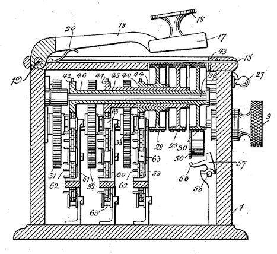

# Hill Cipher



> **One line summary:** The Hill Cipher locks letters in **pairs (or triples)** by multiplying them with a secret **matrix**. We write the **plaintext first, then the key** (P × K). To unlock, we write the **ciphertext first, then the inverse key** (C × K⁻¹).

**Contents**

1. [Basics](#1-basics)
2. [Encryption](#2-encryption)
3. [Decryption](#3-decryption)
4. [Python code (3 files)](#4-python-code-3-files)
5. [Common mistakes](#5-common-mistakes)
6. [Quick cheat sheet](#6-quick-cheat-sheet)

---

## 1. Basics

The Hill Cipher is a **polyalphabetic substitution cipher** built on **linear algebra**. It encrypts a whole *block* of letters at once, so simple frequency analysis (counting the most common letters) does not break it easily.

### 1.1 Letters to Numbers

| A | B | C | D | E | F | G | H | I | J | K | L | M |
|---|---|---|---|---|---|---|---|---|---|---|---|---|
| 0 | 1 | 2 | 3 | 4 | 5 | 6 | 7 | 8 | 9 | 10 | 11 | 12 |

| N | O | P | Q | R | S | T | U | V | W | X | Y | Z |
|---|---|---|---|---|---|---|---|---|---|---|---|---|
| 13 | 14 | 15 | 16 | 17 | 18 | 19 | 20 | 21 | 22 | 23 | 24 | 25 |

### 1.2 What is "mod 26"?

`mod 26` means **"divide by 26 and keep only the remainder"**. It keeps every number between 0 and 25 so it can turn back into a letter.

| Calculation | Result |
|---|---|
| 103 mod 26 | 25 |
| 26 mod 26 | 0 |
| 172 mod 26 | 16 |

### 1.3 The Key Matrix **K**

* A secret square matrix (2×2 or 3×3). This notebook uses **2×2**.
* **Golden rule:** the key must be **invertible mod 26**. That means:

$$\det(K) = (a \cdot d - b \cdot c) \bmod 26$$

* `det(K)` must **not be 0**, and must share **no common factor with 26** (26 = 2 × 13), so `det(K)` must be **odd and not 13**.

> **Why this matters:** a key that fails this rule can still *encrypt*, but you can **never decrypt** it.
> Example: key word `GYBN` → matrix `[[6, 24], [1, 13]]` → det = 78 − 24 = 54 mod 26 = **2** (invalid, because 2 shares a factor with 26).

### 1.4 Our example key

Key word **`DDCF`** to `D=3, D=3, C=2, F=5`

$$K = \begin{pmatrix} 3 & 3 \\ 2 & 5 \end{pmatrix}$$

Check: $\det(K) = (3 \cdot 5 - 3 \cdot 2) \bmod 26 = 9$. It is odd and not 13, so this is a **valid key**.

### 1.5 Row vectors

In this notebook each pair of letters is written as a **row**, with the plaintext on the left:

$$P = \begin{pmatrix} p_1 & p_2 \end{pmatrix}$$

---

## 2. Encryption

### 2.1 Formula

$$C = (P \times K) \bmod 26$$

* **P** = plaintext row (a pair of letters as numbers)
* **K** = key matrix
* **C** = ciphertext row

For a 2×2 key, multiplying a row by a matrix works like this:

$$\begin{pmatrix} p_1 & p_2 \end{pmatrix} \begin{pmatrix} a & b \\ c & d \end{pmatrix} = \begin{pmatrix} p_1 \cdot a + p_2 \cdot c & \; p_1 \cdot b + p_2 \cdot d \end{pmatrix}$$

### 2.2 Steps

1. Remove spaces, make everything CAPITAL.
2. If the number of letters is odd, **pad with `X`** (value 23).
3. Split into pairs → row vectors.
4. Multiply **P × K** for each pair.
5. Apply **mod 26**.
6. Convert numbers back to letters.

### 2.3 Worked example - plaintext `ACT`

**Step 1: Pad.** `ACT` has 3 letters (odd) → add `X` → **`ACTX`**

**Step 2: Split into pairs.**

$$P_1 = (A \;\; C) = (0 \;\; 2), \qquad P_2 = (T \;\; X) = (19 \;\; 23)$$

**Step 3: Block 1 - `AC`**

$$C_1 = \begin{pmatrix} 0 & 2 \end{pmatrix}\begin{pmatrix} 3 & 3 \\ 2 & 5 \end{pmatrix} = \begin{pmatrix} 0\cdot3 + 2\cdot2 & 0\cdot3 + 2\cdot5 \end{pmatrix} = \begin{pmatrix} 4 & 10 \end{pmatrix}$$

$$\begin{pmatrix} 4 \bmod 26 & 10 \bmod 26 \end{pmatrix} = \begin{pmatrix} 4 & 10 \end{pmatrix} \Rightarrow (E \;\; K)$$

**Step 4: Block 2 - `TX`**

$$C_2 = \begin{pmatrix} 19 & 23 \end{pmatrix}\begin{pmatrix} 3 & 3 \\ 2 & 5 \end{pmatrix} = \begin{pmatrix} 19\cdot3 + 23\cdot2 & 19\cdot3 + 23\cdot5 \end{pmatrix} = \begin{pmatrix} 103 & 172 \end{pmatrix}$$

$$\begin{pmatrix} 103 \bmod 26 & 172 \bmod 26 \end{pmatrix} = \begin{pmatrix} 25 & 16 \end{pmatrix} \Rightarrow (Z \;\; Q)$$

### Final ciphertext: **`EKZQ`**

---

## 3. Decryption

### 3.1 Idea

Encryption multiplied by **K**. To undo it, multiply by the **inverse key K⁻¹**, again with the ciphertext on the left:

$$P = (C \times K^{-1}) \bmod 26$$

### 3.2 Finding K⁻¹ (3 mini steps)

**Step A — Determinant**

$$\det(K) = (3 \cdot 5 - 3 \cdot 2) \bmod 26 = 9$$

**Step B - Modular inverse of the determinant**

Find a number `x` such that `9 × x mod 26 = 1`.

| x | 9 × x | mod 26 |
|---|---|---|
| 1 | 9 | 9 |
| 2 | 18 | 18 |
| **3** | **27** | **1 (match)** |

So the inverse of 9 is **3**.

**Step C - Build K⁻¹**

For a 2×2 matrix $\begin{pmatrix} a & b \\ c & d \end{pmatrix}$, swap `a` and `d`, negate `b` and `c`, then multiply by the inverse determinant:

$$K^{-1} = 3 \times \begin{pmatrix} 5 & -3 \\ -2 & 3 \end{pmatrix} \bmod 26 = \begin{pmatrix} 15 & -9 \\ -6 & 9 \end{pmatrix} \bmod 26 = \begin{pmatrix} 15 & 17 \\ 20 & 9 \end{pmatrix}$$

(Negative numbers are fixed by adding 26: −9 → 17, −6 → 20.)

### 3.3 Worked example - ciphertext `EKZQ`

**Block 1 - `EK`** = (4, 10)

$$\begin{pmatrix} 4 & 10 \end{pmatrix}\begin{pmatrix} 15 & 17 \\ 20 & 9 \end{pmatrix} = \begin{pmatrix} 4\cdot15 + 10\cdot20 & 4\cdot17 + 10\cdot9 \end{pmatrix} = \begin{pmatrix} 260 & 158 \end{pmatrix} \bmod 26 = \begin{pmatrix} 0 & 2 \end{pmatrix} \Rightarrow (A \;\; C)$$

**Block 2 - `ZQ`** = (25, 16)

$$\begin{pmatrix} 25 & 16 \end{pmatrix}\begin{pmatrix} 15 & 17 \\ 20 & 9 \end{pmatrix} = \begin{pmatrix} 25\cdot15 + 16\cdot20 & 25\cdot17 + 16\cdot9 \end{pmatrix} = \begin{pmatrix} 695 & 569 \end{pmatrix} \bmod 26 = \begin{pmatrix} 19 & 23 \end{pmatrix} \Rightarrow (T \;\; X)$$

### Recovered text: **`ACTX`** (the final `X` is just padding)

---

## 4. Python code (3 files)

Keep all three files in the **same folder**, then run `python main.py`.

| File | Job |
|---|---|
| `encryption.py` | plaintext to ciphertext |
| `decryption.py` | ciphertext to plaintext |
| `main.py` | the file you run; holds the key |

### 4.1 `encryption.py`

```python
def encrypt(text, key):
    text = "".join(c for c in text.upper() if c.isalpha())   # letters only, CAPITAL
    if len(text) % 2 == 1:                                    # odd? add X
        text += "X"

    result = ""
    for i in range(0, len(text), 2):
        a = ord(text[i]) - 65                                 # A=0 ... Z=25
        b = ord(text[i + 1]) - 65
        x = (a * key[0][0] + b * key[1][0]) % 26              # P x K  (mod 26)
        y = (a * key[0][1] + b * key[1][1]) % 26
        result += chr(x + 65) + chr(y + 65)                   # numbers -> letters
    return result
```

### 4.2 `decryption.py`

```python
def decrypt(text, key):
    det = (key[0][0] * key[1][1] - key[0][1] * key[1][0]) % 26
    inv_det = pow(det, -1, 26)                                # modular inverse of det

    inv_key = [
        [ key[1][1] * inv_det % 26, -key[0][1] * inv_det % 26],
        [-key[1][0] * inv_det % 26,  key[0][0] * inv_det % 26],
    ]

    result = ""
    for i in range(0, len(text), 2):
        a = ord(text[i]) - 65
        b = ord(text[i + 1]) - 65
        x = (a * inv_key[0][0] + b * inv_key[1][0]) % 26      # C x K^-1  (mod 26)
        y = (a * inv_key[0][1] + b * inv_key[1][1]) % 26
        result += chr(x + 65) + chr(y + 65)
    return result
```

### 4.3 `main.py`

```python
from encryption import encrypt
from decryption import decrypt

key = [[3, 3],
       [2, 5]]          # same key as DDCF above

message = input("Enter your message: ")

secret = encrypt(message, key)
print("Encrypted:", secret)

print("Decrypted:", decrypt(secret, key))
```

### 4.4 Sample run

```text
Enter your message: ACT
Encrypted: EKZQ
Decrypted: ACTX
```

---

## 5. Common mistakes

| Mistake | Fix |
|---|---|
| Key with det = 0, even, or 13 | Check `det` first, it must be coprime with 26 |
| Forgetting `mod 26` | Always reduce **after** multiplying |
| Negative numbers after `mod` | Add 26 until the number is between 0 and 25 |
| Odd number of letters | Pad with `X` |
| Multiplying in the wrong order | Here it is **P × K** (plaintext first), and **C × K⁻¹** for decryption |
| Spaces and symbols in the message | Remove them first (the code does this) |

---

## 6. Quick cheat sheet

```text
Encrypt :  C = (P × K)   mod 26      (plaintext first, then key)
Decrypt :  P = (C × K⁻¹) mod 26      (ciphertext first, then inverse key)

K⁻¹ for [[a, b], [c, d]]  =  inv(det) × [[ d, -b], [-c,  a]]  (mod 26)
det     =  (a·d − b·c) mod 26        → must be coprime with 26
```
