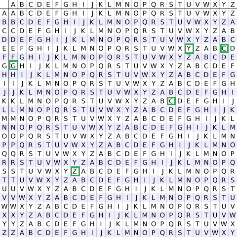

# What is Vigenère Cipher?

The **Vigenère Cipher** is a polyalphabetic substitution cipher that encrypts alphabetic text using a keyword and multiple substitution alphabets (a series of different Caesar ciphers).

---

## 1. Mathematical Formulas

To process the text, every letter is mapped to a numeric index from **0 to 25** (\(A = 0, B = 1, \dots, Z = 25\)).

### Encryption Formula

For each character at position i:
\[C_i = (P_i + K_i) \pmod{26}\]

### Decryption Formula

For each character at position i:
\[P_i = (C_i - K_i + 26) \pmod{26}\]

*Where:*

* \(P_i\) = Plaintext letter index at position i
* \(C_i\) = Ciphertext letter index at position i
* \(K_i\) = Key letter index at position i (from the repeated keyword)

---

## 2. Encryption Algorithm

1. **Start**
2. Input the plaintext.
3. Input the encryption key (keyword).
4. Repeat the keyword cyclically until its length matches the length of the plaintext.
5. For each character in the plaintext:
   * If it is an English letter, convert it to its alphabet index.
   * Calculate the encrypted index (\(C_i\)):
     \[C_i = (P_i + K_i) \pmod{26}\]
   * Convert the new index \(C_i\) back into a letter.
   * Preserve non-alphabetic characters unchanged.
6. **Display the ciphertext.**
7. **Stop**

---

## 3. Decryption Algorithm

1. **Start**
2. Input the ciphertext.
3. Input the encryption key.
4. Repeat the keyword cyclically until its length matches the length of the ciphertext.
5. For each character in the ciphertext:
   * If it is an English letter, convert it to its alphabet index.
   * Calculate the decrypted index (\(P_i\)):
     \[P_i = (C_i - K_i + 26) \pmod{26}\]
   * Convert the new index \(P_i\) back into a letter.
   * Preserve non-alphabetic characters unchanged.
6. **Display the plaintext.**
7. **Stop**

---

## 4. Vigenère Table

---

## 5. Complete Example

* **Plaintext:** `HELLO`
* **Key:** `KEY`
* **Repeated Key:** `KEYKE`

### Step-by-Step Breakdown

| Character Position (i) | Plaintext (\(P_i\)) | Key (\(K_i\)) | Encryption: \((P_i + K_i) \pmod{26}\) | Ciphertext (\(C_i\)) |
| :---: | :---: | :---: | :---: | :---: |
| 0 | `H` (7) | `KEY` → `K` (10) | \((7 + 10) \pmod{26} = 17\) | `R` |
| 1 | `E` (4) | `KEY` → `E` (4) | \((4 + 4) \pmod{26} = 8\) | `I` |
| 2 | `L` (11) | `KEY` → `Y` (24) | \((11 + 24) \pmod{26} = 9\) | `J` |
| 3 | `L` (11) | `KEYKE` → `K` (10) | \((11 + 10) \pmod{26} = 21\) | `V` |
| 4 | `O` (14) | `KEYKE` → `E` (4) | \((14 + 4) \pmod{26} = 18\) | `S` |

* **Final Ciphertext:** `RIJVS`
* **Decrypted Text:** `HELLO`
